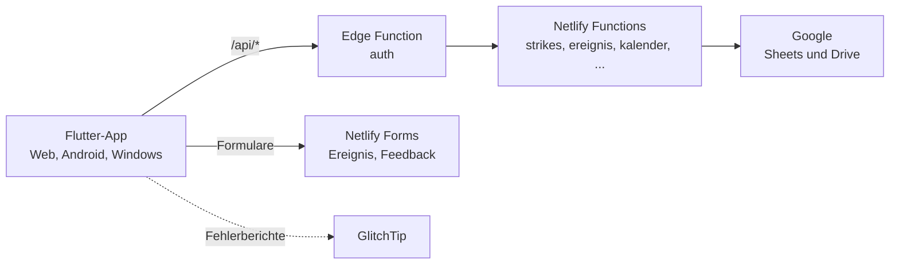

<div align="center">

# JUBL(A)PP

**Die App für die Gruppenstunde: Strikes, Ereignisse, Wetter und Links an einem Ort.**

[](https://github.com/flohulo/jublapp/actions/workflows/ci.yml)
[](https://app.netlify.com/projects/jubla-wald-reporting/deploys)


[](LICENSE)

</div>

Die JUBL(A)PP unterstützt Leitende der Jubla Wald ZH im Scharalltag. Sie läuft auf dem Smartphone, im Browser und unter Windows, aus einer einzigen Flutter-Codebasis, und ist mit dem Netlify-Backend der Schar verbunden.

## Funktionen

| Funktion              | Wofür                                                |
| --------------------- | ---------------------------------------------------- |
| **Strike**            | Strikes für bis zu vier Kinder erfassen              |
| **Ereignis melden**   | Unfälle, Konflikte und Sachschäden dokumentieren     |
| **Wetter**            | Wetter für die Gruppenstunde im Blick                |
| **Links**             | Notfallnummern, Jubla-Webseiten und Kontakte         |
| **Lager**             | Padlet der Schar fürs Lager, im Web eingebettet      |
| **Feedback**          | Fehler melden und Ideen einreichen, direkt in der App |

Die Anleitungen für Leitende stehen im Handbuch (Quelltext in [`docs/`](docs/index.md)). Es wird beim Deploy unter `dist/handbuch` veröffentlicht.

## Aufbau



| Ordner                    | Inhalt                                              |
| ------------------------- | --------------------------------------------------- |
| `app/`                    | Flutter-App                                         |
| `backend/functions/`      | Netlify Functions (API-Endpunkte)                   |
| `backend/edge-functions/` | Auth-Prüfung vor allen Daten-Endpunkten             |
| `web-extras/forms.html`   | Formular-Deklaration für Netlify Forms              |
| `app/assets/locales/`     | Übersetzungen (Deutsch, Schweizerdeutsch, Französisch, Italienisch, Englisch) |
| `docs/`                   | Handbuch (MkDocs)                                   |

## Loslegen

Voraussetzungen: Node.js, npm, [Flutter](https://docs.flutter.dev/get-started/install) 3.47.9 und die Netlify CLI.

```bash
npm install
cp .env.example .env.local   # Werte eintragen, nie committen
npm run dev                  # Web-App bauen und lokal mit Backend starten
npm test                     # flutter analyze und flutter test
```

Mehr dazu, zur Projektstruktur und zu Übersetzungen steht in [CONTRIBUTING.md](CONTRIBUTING.md). Befehle zur Flutter-App findest du in [`app/README.md`](app/README.md).

## Mitmachen

Beiträge sind willkommen. Bitte lies zuerst [CONTRIBUTING.md](CONTRIBUTING.md). Sicherheitsprobleme meldest du privat gemäss [SECURITY.md](SECURITY.md).

## Lizenz

[GNU Affero General Public License v3.0](LICENSE)
